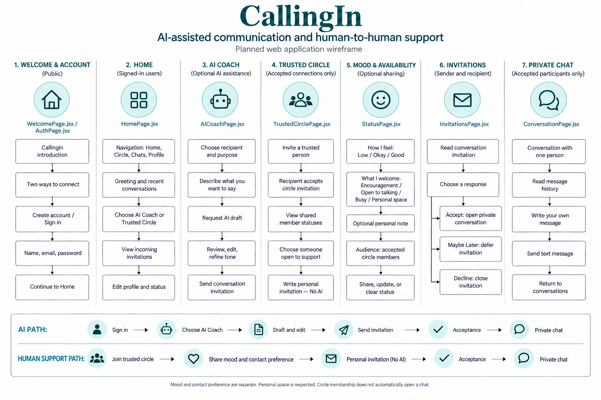

# CallingIn

### Helping people begin the conversations that matter most

CallingIn is my Fall 2026 project for **CS 8674 – Project Course**
in the **M.S. in Computer Science (ALIGN)** program.

- **Student:** Shorena K. Anzhilov
- **Faculty Advisor:** Professor Albert Lionelle
- **Project period:** September–December 2026
- **Status:** Planning and initial development

## Overview

Starting a conversation can be harder than sending a message.

Someone may want to reconnect with a friend, express appreciation,
offer an apology, or discuss something difficult but feel unsure
how to begin.

CallingIn explores how generative AI can help people find the words
while preserving their own voice and intentions. Users explain what
they want to express, review an AI-assisted draft, and send a
conversation invitation. The recipient chooses whether they are
ready to connect.

The Fall 2026 MVP focuses on this AI-assisted communication pathway.

## Mission

CallingIn's mission is to make meaningful communication easier by
helping people begin conversations they might otherwise avoid.

The application is designed around thoughtful expression, personal
choice, and respect for boundaries. AI offers suggestions, while
users remain in control of their words and decisions.

## Research Question

> How can Generative AI assist individuals in initiating meaningful
> interpersonal conversations while preserving authenticity and
> emotional intent?

The project combines software development with research on
AI-assisted communication, human-computer interaction, and
responsible design.

## Semester MVP

### 1. Accounts and Profiles

Users will be able to register, sign in, sign out, and maintain
a basic profile.

### 2. AI Communication Coach

Users will explain why they want to reach out and request help
drafting a message.

The coach will support:

- Drafting a message from the user's stated intent.
- Refining wording for clarity.
- Adjusting tone.
- Reviewing and editing suggestions before sending.

AI will not send messages on the user's behalf.

### 3. Conversation Invitations

A user will choose a recipient, prepare a message, and send an
invitation to connect.

The planned responses are:

| Response | Behavior |
| --- | --- |
| Accept | Opens a private conversation |
| Maybe Later | Keeps the invitation available for later consideration |
| I need some space | Closes the invitation without opening a conversation |

The final wording will be reviewed during interface design.
Choosing not to connect does not create an obligation to respond later.

### 4. Private One-to-One Messaging

After an invitation is accepted, the two participants will be able
to exchange text messages in a private conversation.

Access will be restricted to the participants through server-side
permission checks.

### 5. Social Battery

Users will be able to share their communication availability:

- Open to conversations.
- Busy.
- Taking personal space.

Social Battery describes availability for contact, not a diagnosis
or an automatic assessment of someone's emotions.

## Example User Journey

1. Sign in to CallingIn.
2. Choose someone to contact.
3. Explain the reason for reaching out.
4. Request an AI-assisted draft.
5. Review and edit the message.
6. Send a conversation invitation.
7. The recipient chooses how to respond.
8. If accepted, begin a private text conversation.

### Example

**User's intent:**

> We haven't talked in a while, and I miss our friendship.

**Possible AI suggestion:**

> I've been thinking about you and would love to catch up
> if you're open to it.

The user can change the suggestion or write their own message
before sending it.

## Scope and Boundaries

The semester MVP will not include:

- Trusted Circle membership or shared mood updates.
- Gratitude List and Life Reflections.
- In-app voice or video calls.
- Group messaging or public social feeds.
- Automatic mood detection.
- Paid subscriptions or premium billing.
- Typing indicators or read receipts.
- AI-generated conversation summaries.

Real-time messaging and end-to-end encryption are not promised
for the initial version.

CallingIn is a communication project. It is not intended to diagnose
or treat mental health conditions or replace professional care.

## Future Improvements

The following features are possibilities for later development and are
outside the Fall 2026 MVP.

### Trusted Circle — Human Support Without AI

A future version may introduce a private, invitation-only circle
of trusted friends and family.

Users could voluntarily share personal experiences, how they feel,
and what kind of contact they welcome. Someone in their circle could
then offer encouragement or invite them to talk using their own words,
without AI involvement.

The idea is grounded in humans supporting humans while respecting
each person's privacy, availability, and boundaries.

### Gratitude List

A personal list of people who positively influenced the user's life,
believed in them, gave them opportunities, or helped change their
life's direction.

Users would be able to:

- Add, edit, and remove names.
- Keep their Gratitude List private by default.
- Optionally share the list with their Trusted Circle.

### Life Reflections

A personal space for preserving philosophical thoughts, observations,
questions, and realizations about life.

Topics might include:

- The meaning of life and happiness.
- Personal growth and lessons learned.
- Relationships, kindness, and human connection.
- Experiences that changed the user's perspective.
- Original philosophical thoughts the user wants to remember.

Users would be able to:

- Create, edit, and save personal reflections.
- Keep reflections private by default.
- Optionally share selected reflections with their Trusted Circle.
- Choose what to share and with whom.
- Edit or remove previously shared reflections.

Life Reflections would focus on authentic human expression.
AI assistance would not be required.

### Other Possible Enhancements

- Real-time message delivery.
- Typing indicators and read receipts.
- Additional AI communication styles.
- Native mobile applications.
- Enhanced privacy features.
- End-to-end encryption.
- A future premium offering.

These are possibilities for later development, not semester commitments.

## Planned Technology Stack

| Area | Technology |
| --- | --- |
| Language | JavaScript |
| Frontend | React, HTML, and CSS |
| Backend | Node.js and Express |
| Database | MongoDB with the native Node.js driver |
| Authentication | Passport.js, server-side sessions, and password hashing |
| AI integration | OpenAI API or another approved language model API |
| Version control | Git and GitHub |

AI API credentials will remain on the backend and will not be
included in frontend code or committed to the repository.

## Architecture

The planned application has three main parts:

1. **React frontend:** Displays pages, forms, invitations, and messages.
2. **Express backend:** Handles authentication, permissions,
   application rules, and AI requests.
3. **MongoDB database:** Stores users, invitations, conversations,
   and messages.

The frontend will communicate with the backend through API requests.
Only the backend will communicate directly with the database and
the AI provider.

## Development Process

Development will follow short sprints with clear deliverables.

Each sprint will include:

- A defined goal and limited scope.
- Small, understandable commits.
- Relevant tests and quality checks.
- Updated documentation.
- A review of completed and unfinished work.

Work will take place on sprint branches and be merged into main
after review.

### Planned Branches

| Sprint | Branch | Focus |
| --- | --- | --- |
| 1 | `sprint-01-planning` | Documentation and application foundation |
| 2 | `sprint-02-authentication` | Accounts, profiles, and database integration |
| 3 | `sprint-03-invitations` | Invitation creation and response workflow |
| 4 | `sprint-04-conversations` | Private messaging and Social Battery |
| 5 | `sprint-05-ai-coach` | AI drafting and refinement |
| 6 | `sprint-06-evaluation` | Evaluation, fixes, and final deliverables |

Future branches will be created when their sprint begins.
This table describes the planned workflow. As of October 12, the local
`sprint-01-planning` branch contains the React and Express starter code;
that source code is not yet present on the local `main` branch.

See the [Sprint Plan](doc/sprint-plan.md) for dates and deliverables.

## Code Quality

The project will use:

- **ESLint:** Detect potential mistakes and enforce coding rules.
- **Prettier:** Keep formatting consistent.
- **Complexity checks:** Identify functions that are difficult
  to understand or test.
- **Pre-commit hooks:** Run selected fast checks before commits.
- **Automated tests:** Verify important behavior and failure paths.
- **Dependency scanning:** Review known vulnerabilities in packages.

### Configuration Status — October 12, 2026

Inspection of the local `sprint-01-planning` branch found:

- `frontend/eslint.config.js` and `backend/eslint.config.js` both
  configure ESLint's complexity rule as an error with a limit of 10.
- Each application has its own lint command.
- Husky and lint-staged configure pre-commit checks for staged files.
- The backend uses Node.js's built-in test runner and includes
  `backend/test/health.test.js`.

A root command for checking both applications together is still needed.
The pre-commit commands also need verification that they load the
correct ESLint configuration from each application's directory.

These findings record configuration inspection, not successful execution
of the checks. Follow-up work should verify linting and complexity checks
across both applications, review edge cases and test coverage, and
record the results before declaring the quality checks complete.

The professor's Rust checklist is retained as reference material.
Its Rust commands do not apply to this JavaScript application.

## Testing and Evaluation

Technical testing will focus on:

- Registration and authentication.
- Invitation states and recipient choices.
- Access restrictions for private conversations.
- Message validation and storage.
- AI request failures.
- The complete invitation-to-conversation flow.

The academic evaluation will consider usability, clarity, and
whether AI suggestions preserve the user's intended meaning
and perceived voice.

Any participant evaluation will follow the advisor's guidance
and applicable university requirements. The final report will
distinguish observed findings from assumptions and limitations.

## Design References

The following images are earlier concept explorations.
They include Trusted Circle and other details that are outside
the current semester scope.

### Interface Concept

### Application Wireframe

Updated visuals will reflect the AI-focused MVP and the final
invitation wording. The wireframe is a PNG concept, not an
editable Figma project.

## Project Documentation

- [Sprint Plan](doc/sprint-plan.md)
- [Daily Commands](doc/commends.md)
- [Sprint 1 Progress](doc/sprint-01/sprint-01-progress.md)
- [Sprint 1 AI Development Log](doc/sprint-01/ai-development-log-1.md)
- [Sprint 1 Testing and Quality Gates](doc/sprint-01/Notes_testing_qualitygate.md)
- [Advisor Meeting 01 — September 15, 2026](doc/meetings/meeting-01_2026-09-15.md)
- [Advisor Meeting 02 — September 29, 2026](doc/meetings/meeting-02_2026-09-29.md)
- [Meeting 02 Preparation Questions](doc/meetings/meeting-02-preparation_2026-09-29.md)
- [Original Project Proposal](doc/CS8674_Project_Proposal_and_Semester_Plan_Shorena_Anzhilov.pdf)
- [Code Quality Tools Chart](materials/code-quality-tools.png)
- [Professor's Rust Quality Checklist](materials/check-rs.md)

Semester-wide documents are in `doc/`, meeting files are in
`doc/meetings/`, and Sprint 1 records are in `doc/sprint-01/`.
The command guide and Sprint 1 verification records describe the starter
on `sprint-01-planning`; the application source has not been merged into `main`.

The original proposal records the initial semester plan.
This README and the sprint plan describe the revised MVP scope.

## Academic Deliverables

- Literature review and references.
- Requirements, wireframes, and architecture.
- Database design.
- Working CallingIn MVP.
- Source code and development documentation.
- Evaluation findings and limitations.
- Final report.
- Project presentation.
- Written reflection.

Advisor meetings are planned every other week beginning
September 15, 2026, with adjustments as needed.

The target project finish is approximately December 11.
Final submission dates will be confirmed with the advisor.
The proposal specifies that the reflection is due on the
Friday before finals week.

## Running the Project

Application setup is in progress on `sprint-01-planning`. The local
`main` branch does not yet contain the starter source or package files.

Installation commands, environment-variable instructions,
and frontend/backend run commands will be added once the
starter applications are configured and verified.

© 2026 Shorena K. Anzhilov. All rights reserved. This source code is publicly available for viewing purposes only. No permission is granted to copy, modify, distribute, or use this code without prior written permission.
