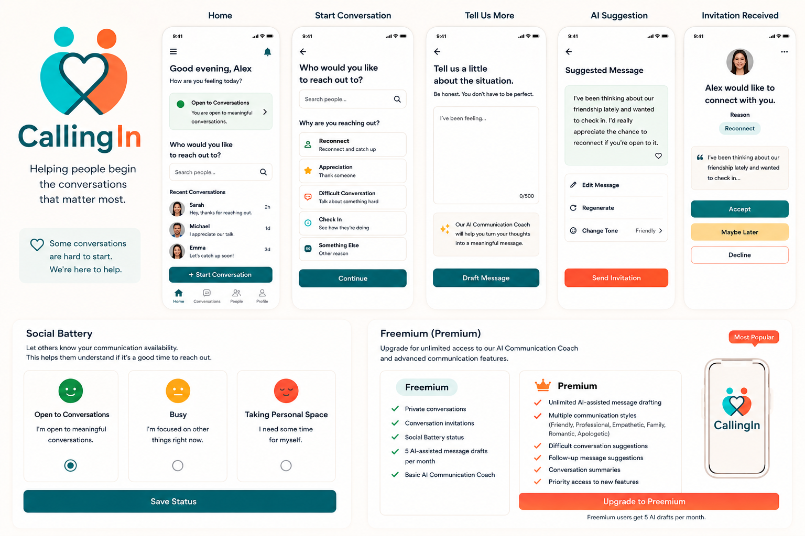
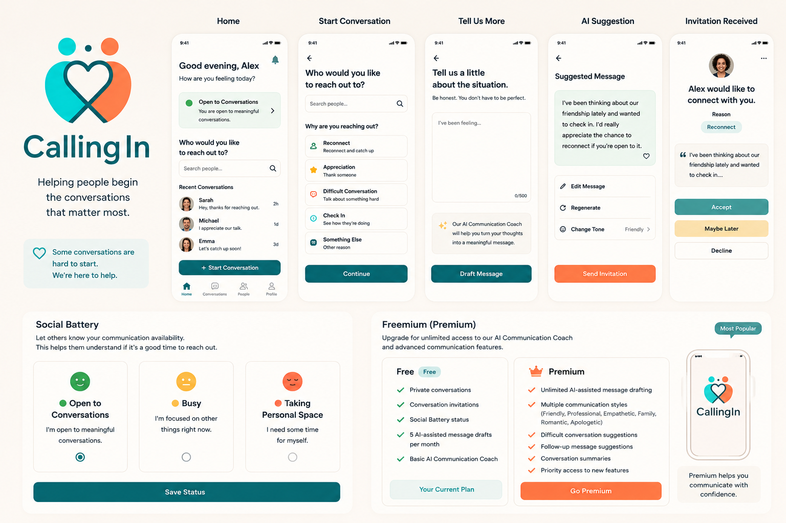
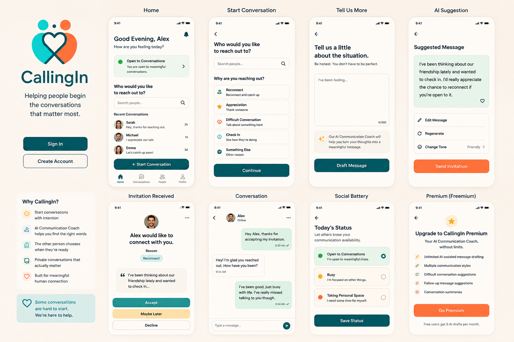
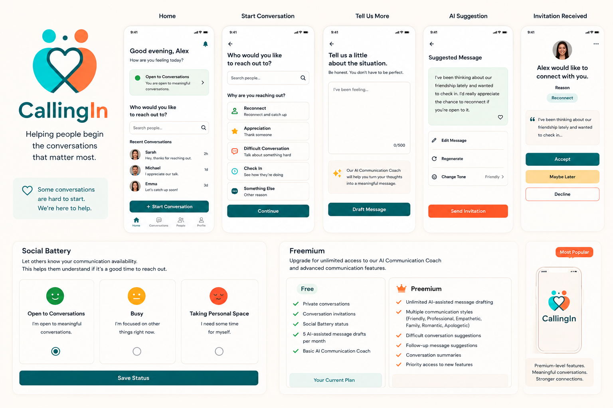
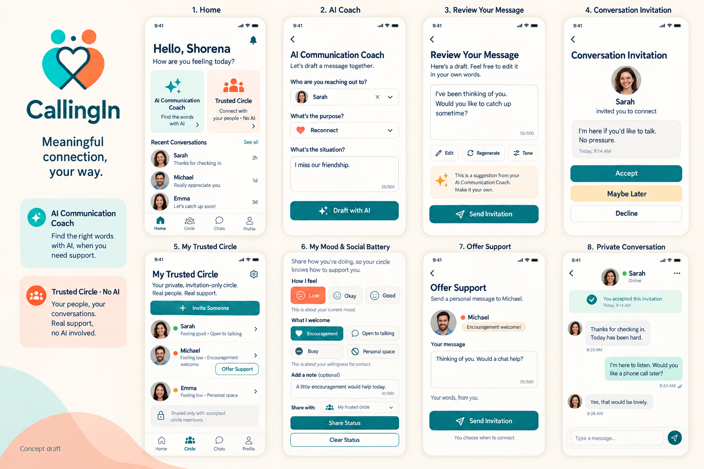

# CallingIn

**Helping People Begin the Conversations That Matter Most**

---

# Overview

**CallingIn** is an intentional communication platform designed to help people start meaningful conversations they might otherwise avoid.

Many people want to reach out to someone but hesitate because they don't know what to say, fear being misunderstood, or worry that their message won't be received well.

CallingIn removes that barrier by guiding users through the entire process of initiating a meaningful conversation from the moment they decide to reconnect until a genuine conversation begins.

At its core, CallingIn exists for one simple reason:

> **"I want to reach out to someone, but I don't know how."**

Unlike traditional messaging apps, CallingIn is not designed for constant chatting or social networking. Instead, it provides a guided communication experience that helps people reconnect with confidence and intention.

---

# Our Mission

Some conversations are difficult to start—but they are often the most important ones.

CallingIn exists to help people feel:

- Seen
- Heard
- Understood
- Appreciated
- Connected

Our mission is to make meaningful communication easier by helping people begin conversations that might never have happened otherwise.

---

# The Problem

Every day, people hesitate before sending a message because they are unsure how to begin.

They may want to:

- Reconnect with an old friend
- Repair a damaged relationship
- Check in on a family member
- Express appreciation
- Offer an apology
- Reach out after years of silence
- Tell someone they matter

Most communication platforms assume people already know what to say.

CallingIn recognizes that beginning the conversation is often the hardest part.

---

# Why CallingIn?

A common question is:

> **"Why wouldn't I just use ChatGPT and WhatsApp?"**

ChatGPT can certainly help rewrite a message.

WhatsApp can deliver it.

CallingIn does much more.

CallingIn owns the **entire communication journey**, not just message writing.

Instead of focusing only on messaging, CallingIn guides users through every step:

1. Choose the person you want to reach.
2. Explain why you want to reconnect.
3. Receive AI guidance to write a thoughtful message.
4. Send an intentional conversation invitation.
5. Allow the recipient to decide if they are ready.
6. Begin a private conversation only after both people agree.

ChatGPT helps with Step 3.

CallingIn manages the complete experience.

---

# Project Vision

CallingIn is designed to remove the emotional friction that prevents meaningful conversations.

The platform helps users communicate thoughtfully without replacing their authentic voice.

Whether someone wants to reconnect after years apart or simply tell another person they matter, CallingIn provides the guidance needed to take that first step.

The goal is **not** to send another message.

The goal is to begin conversations that may never have happened otherwise.

---

# Core Features

## 1. Intentional Conversation Requests

Every conversation begins with purpose.

Instead of opening a chat immediately, users intentionally choose someone they would like to contact and explain why they are reaching out.

Examples include:

- Reconnecting with a friend
- Checking on a loved one
- Expressing gratitude
- Offering an apology
- Repairing a relationship
- Starting an important discussion

---

## 2. AI Communication Coach

CallingIn includes an AI Communication Coach that helps users express themselves more clearly while preserving their own voice.

The AI is intentionally supportive—not generative.

Its purpose is to help people communicate more effectively, not to replace authentic communication.

### AI Capabilities

- Rewrite difficult messages
- Improve clarity
- Adjust tone
- Reduce emotionally charged language
- Build confidence before sending

### Example

**User writes:**

> "I feel ignored."

**CallingIn suggests:**

> "I've been thinking about our friendship lately and wanted to check in. I'd really appreciate the chance to reconnect if you're open to it."

---

## 3. Conversation Invitation Flow

Instead of sending a message immediately, CallingIn first sends an intentional invitation.

**Example:**

> **Alex would like to start a meaningful conversation with you.**

The recipient may choose:

- ✅ Accept
- ⏳ Maybe Later
- ❌ Decline

Only after the invitation is accepted does a private conversation begin.

This creates mutual consent before communication starts.

---

## 4. Private Conversations

Once both users agree, CallingIn opens a private one-on-one messaging space.

The platform intentionally avoids becoming another social media application.

CallingIn does **not** include:

- Voice calls
- Video calls
- Voice messages
- Group chats
- Stories
- Public posts
- News feeds

The focus remains entirely on meaningful conversations.

---

## 5. Social Battery

Users can optionally share their current communication availability.

### Status Options

- 🟢 Open to Conversations
- 🟡 Busy
- 🔴 Taking Personal Space

This feature helps others understand whether it may be a good time to reach out while respecting personal boundaries.

---

# User Journey

The CallingIn experience follows a simple guided flow:

1. Create an account.
2. Set your Social Battery status.
3. Select the person you would like to contact.
4. Explain why you want to reach out.
5. Receive assistance from the AI Communication Coach.
6. Send a conversation invitation.
7. The recipient chooses:
   - Accept
   - Maybe Later
   - Decline
8. If accepted, a private conversation begins.

---

# Freemium Business Model

CallingIn follows a freemium subscription model.

## Free Plan

Users can always:

- Create conversation invitations.
- Participate in private one-on-one conversations.
- Update their Social Battery status.
- Receive **5 AI-assisted message drafts per month.**
- Use the Basic AI Communication Coach.

> **Messaging is always free.**

---

## Premium Plan

Premium enhances the communication experience with advanced AI features.

Premium includes:

- Unlimited AI-assisted message drafting
- Advanced AI Communication Coach
- Multiple communication styles:
  - Friendly
  - Professional
  - Empathetic
  - Family
  - Romantic
  - Apologetic
- Difficult conversation guidance
- Follow-up message suggestions
- AI-generated conversation summaries

> **CallingIn will never charge users simply to exchange messages.**

Premium exists only to provide additional communication support.

---

# Technology Stack

## Frontend

- React
- React Hooks
- HTML5
- CSS3
- Fetch API

## Backend

- Node.js
- Express.js

## Database

- MongoDB
- Native MongoDB Node.js Driver

## Authentication

- Passport.js

## AI Integration

- OpenAI API (or another compatible Large Language Model)

---

# Database Collections

The application stores data in the following collections:

- Users
- Conversation Requests
- Conversations
- Messages

---

# Future Roadmap

Planned future enhancements include:

- Native iOS application
- Native Android application
- Additional AI communication styles
- Relationship reminders
- Personalized communication insights
- Premium subscription enhancements
- Enhanced privacy controls
- End-to-end encryption

---

# What Makes CallingIn Different?

CallingIn is **not** another messaging application.

It is an intentional communication platform built around one simple belief:

> **Starting the conversation is often the hardest part.**

Instead of encouraging endless messaging, CallingIn helps people reconnect with confidence, empathy, and purpose.

Every feature—from the AI Communication Coach to conversation invitations and the Social Battery—is designed to make meaningful human connection easier.

---

# Closing Statement

Some conversations can change relationships.

They can heal misunderstandings.

Restore friendships.

Reconnect families.

Or simply remind someone they are valued.

Those conversations deserve more than another chat window.

## CallingIn helps people begin the conversations that matter most.

--- Temp Images ---
>** my fav THE 1 option **

>** THE 2 option **

>** my fav THE 1 option **

>** THE 2 option **

-----------
new feture added 

=== Previous Projects To Use ===

https://github.com/ShorenaK/GeoGoHub

https://github.com/ShorenaK/GeoGoHub/tree/final-project-iteration

https://github.com/ShorenaK/GeoWellHub