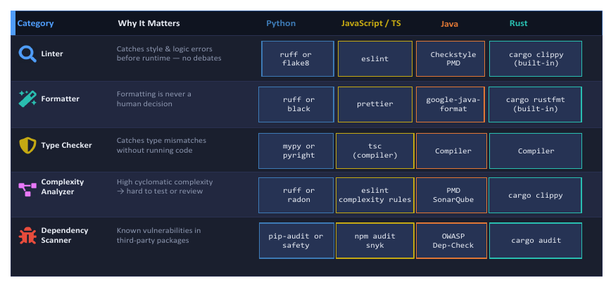

# Advisor Meeting 01

**Course:** CS 8674 – Project Course  
**Semester:** Fall 2026  
**Date:** September 15, 2026  
**Student:** Shorena K. Anzhilov  
**Advisor:** Professor Albert Lionelle

## Meeting Summary

We discussed CallingIn's proposed technology stack, development
process, code quality, and repository management.

I proposed React, Node.js, and MongoDB based on my experience
with JavaScript and React.

Professor Lionelle discussed Angular's stronger conventions and
the need for deliberate architecture when using React.

His recommendations were guidance rather than mandatory requirements.

## Advisor Recommendations

- Organize development into sprints with clear deliverables.
- Create a separate Git branch for each sprint.
- Review and merge completed sprint work into main.
- Use ESLint and Prettier.
- Check code complexity and avoid unnecessary duplication.
- Configure pre-commit hooks for automated quality checks.
- Maintain meaningful tests while keeping test execution practical.
- Document design decisions and minimize technical debt.

## Repository and Collaboration

- Keep the project repository private.
- Add Professor Lionelle as a collaborator for review and feedback.

### Action Item

- [ ] Confirm that Professor Lionelle has repository access.

## Supporting Materials

### Code Quality Tools Chart

The chart covers linting, formatting, type checking,
complexity analysis, and dependency scanning.

### Rust Quality Checklist

[Rust checklist reference](../../materials/check-rs.md)

This is reference material. Its review principles can be adapted
to JavaScript; its Rust commands do not apply to CallingIn.

## Subsequent Project Decisions

These decisions were made after the meeting:

- Focus the semester MVP on AI-assisted communication.
- Move Trusted Circle to Future Improvements.
- Retain basic Social Battery availability.
- Propose React with JavaScript, Node.js, Express, and MongoDB.
- Include documentation and starter code in Sprint 1.

## Meeting Schedule

Meet every other week, beginning September 15:

- September 15
- September 29
- October 13
- October 27
- November 10
- November 24
- December 8

Individual dates may change. The target project finish is
approximately December 11.

## Next Steps

- [ ] Finalize the revised MVP scope and README.
- [ ] Review the sprint schedule.
- [ ] Begin work on sprint-01-planning.
- [ ] Set up the React and Express foundation.
- [ ] Configure initial code-quality checks.

See the [Sprint plan](../sprint-plan.md) for deliverables.
